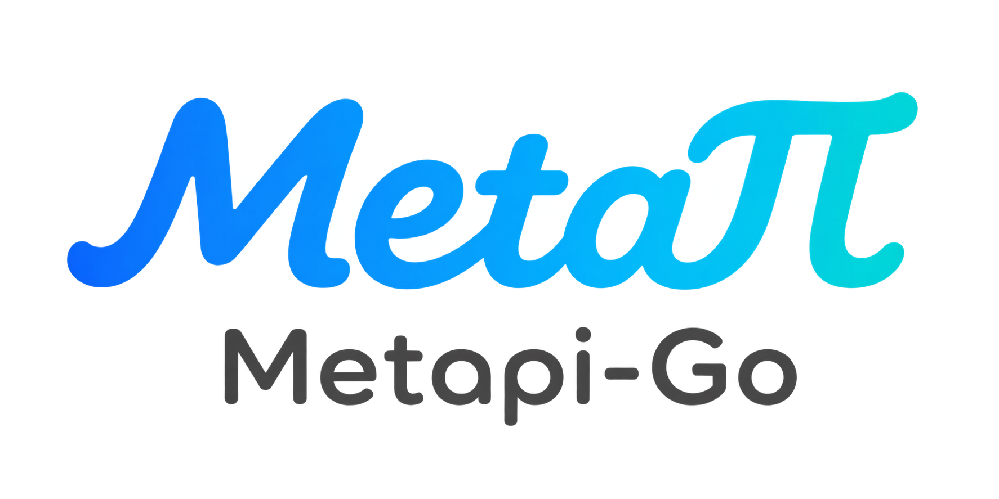
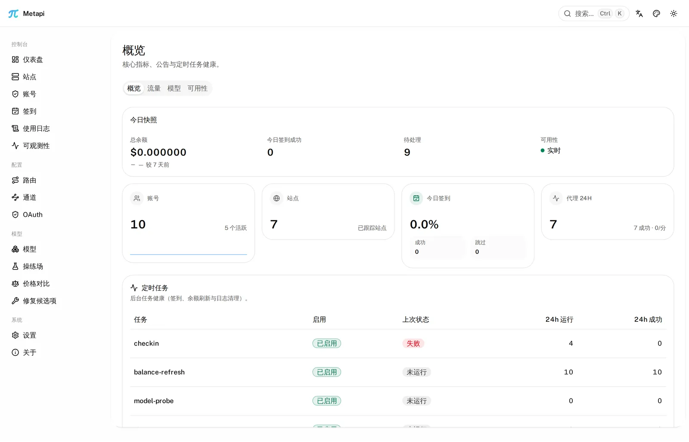
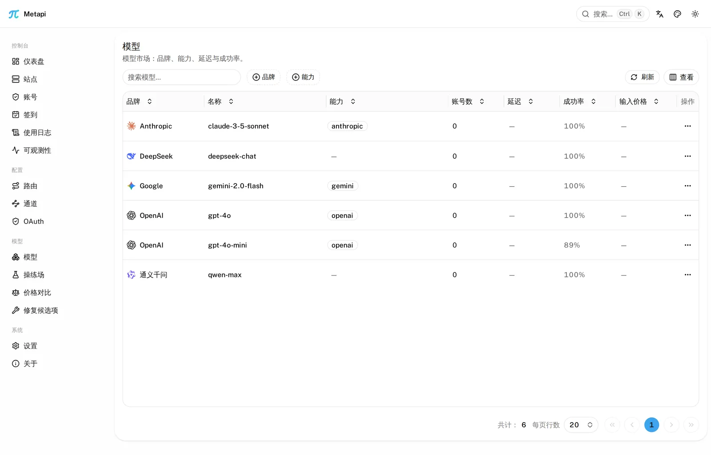
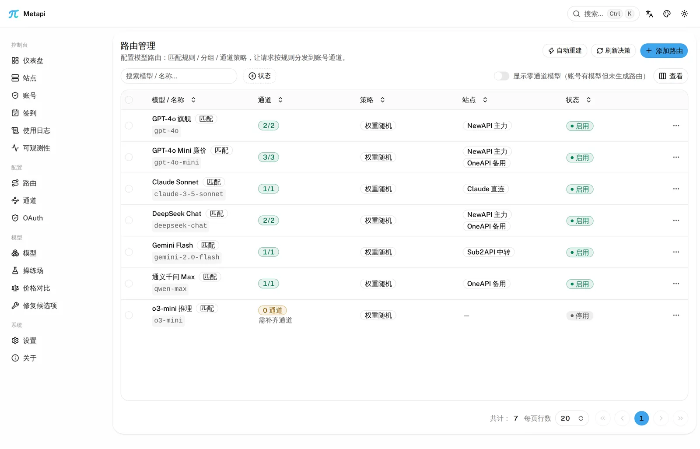
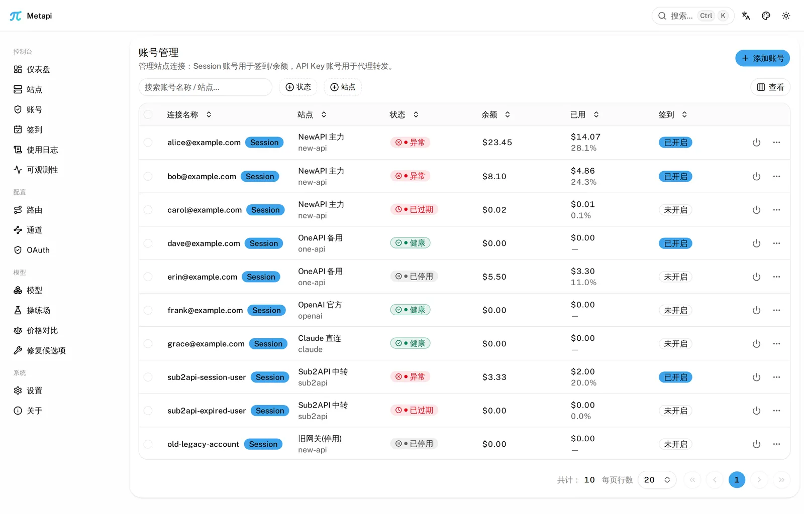
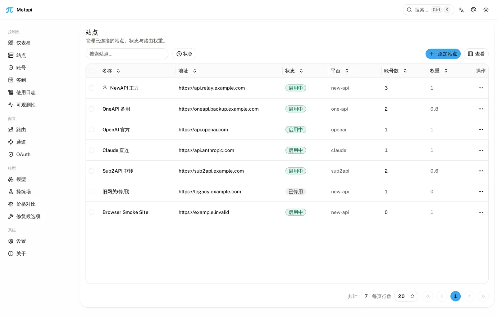
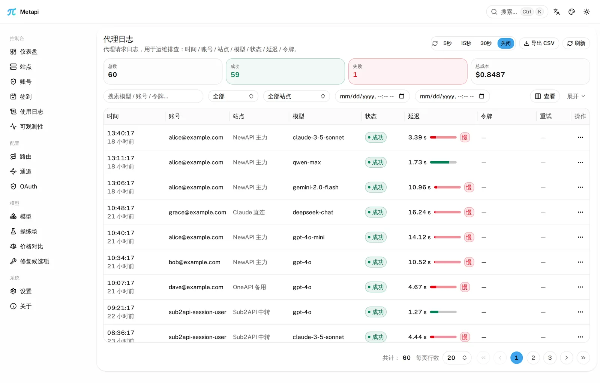
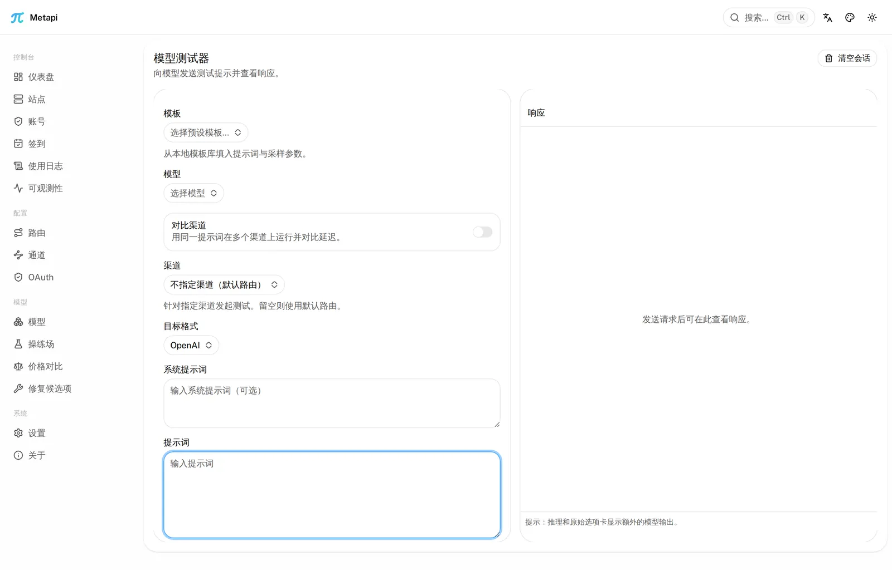
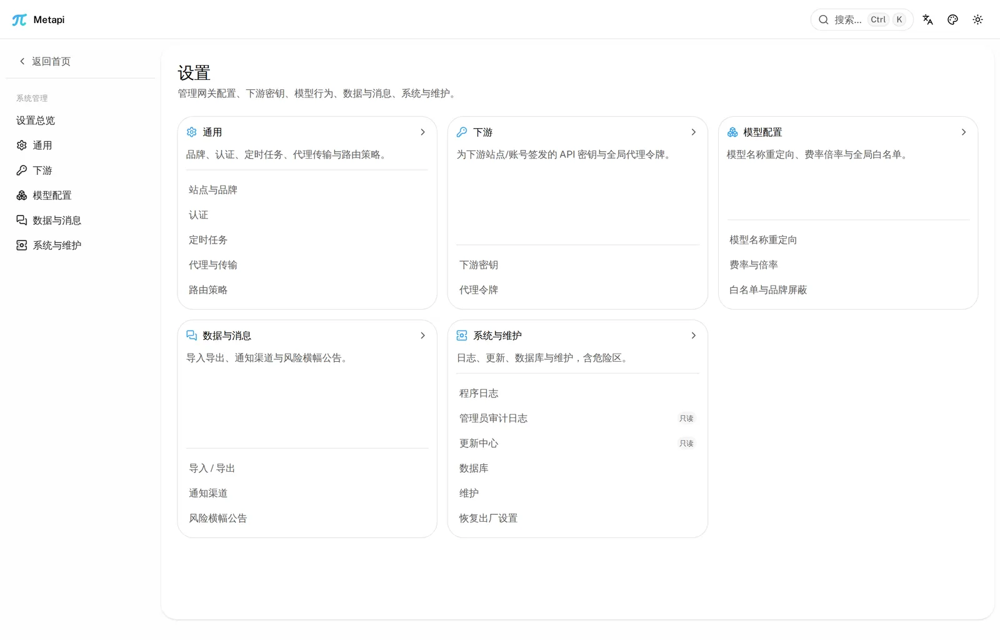

<p align="center">
  
</p>

<h1 align="center">Metapi Go</h1>

<p align="center">
  <strong>The relay-of-relays — aggregate scattered AI API sites into one unified gateway</strong>
</p>

<p align="center">
  One key for every AI gateway.<br>
  Unify the New API / One API / OneHub / Sub2API sites you registered everywhere into
  <strong>a single API key and a single entrypoint</strong> — with automatic model
  discovery, smart routing and cost-optimal channel selection.
</p>

<p align="center">
  <a href="README.md">中文</a> ·
  <a href="README_EN.md"><strong>English</strong></a>
</p>

<p align="center">
  <a href="https://github.com/DeliciousBuding/metapi-go/actions/workflows/main.yml"></a>
  <a href="https://github.com/DeliciousBuding/metapi-go/releases/latest"></a>
  <a href="https://github.com/DeliciousBuding/metapi-go/pkgs/container/metapi-go"></a>
  
  <a href="LICENSE"></a>
</p>

<p align="center">
  <a href="#features"><strong>Features</strong></a> ·
  <a href="#screenshots">Screenshots</a> ·
  <a href="#quick-start-3-minutes"><strong>Quick Start</strong></a> ·
  <a href="#deployment--configuration">Deployment</a> ·
  <a href="#migrating-from-the-typescript-version">Migration</a> ·
  <a href="#known-limitations">Limitations</a>
</p>

---

## What is Metapi

The AI ecosystem is full of aggregation relays built on New API / One API and
friends, and balances, model lists and API keys end up scattered across many
of them. **Metapi** is the **meta-aggregation layer** above those relays: it
unifies your sites behind **one entrypoint**, so every downstream tool —
Cursor, Claude Code, Codex, Open WebUI and anything that speaks OpenAI —
reaches all of your models transparently.

Supported upstreams:

- **Aggregation panels**: New API, One API, OneHub, DoneHub, Veloera, AnyRouter, Sub2API
- **Compatible endpoints**: OpenAI / Claude / Gemini compatible APIs, plus `cliproxyapi` / CPA
- **OAuth connections**: Codex, Claude, Gemini CLI, Antigravity, GitHub Copilot

## Features

| Capability                 | Description                                                                                                                                    |
| -------------------------- | ---------------------------------------------------------------------------------------------------------------------------------------------- |
| **17 upstream adapters**   | New API / One API / OneHub / DoneHub / Veloera / AnyRouter / Sub2API / OpenAI / Claude / Gemini / Gemini CLI / Codex / Antigravity / Grok / GitHub Copilot / CLIProxyAPI / SenseTime |
| **Unified proxy**          | OpenAI and Claude protocols side by side: Chat / Responses / Messages / Embeddings / Images / Models / Files, SSE streaming; Messages-to-Chat text/function-tool fallback with JSON/SSE return conversion |
| **Routing & fault tolerance** | Automatic model discovery and channel binding; opt-in creation of missing model routes (off by default); observable background rebuilds; multi-channel allocation weighted by cost / balance / usage; failed channels cool down while the request retries on the next; runtime circuit breaker with half-open probing |
| **Cost ground truth**      | Four-level cost signal (measured → account-configured → models.dev catalog → fallback); every request logged with tokens and cost            |
| **Admin UI**               | Sites / accounts / routes / models / logs / alerts in one SPA, pre-built and embedded into the binary — no separate frontend service needed  |
| **Operations automation**  | Scheduled check-ins, scheduled balance refresh, nine alert channels, batch model verification, audit log, realtime QPS panel                 |
| **Lightweight deployment** | A single binary is enough; SQLite by default, PostgreSQL optional; idempotent schema upgrades run automatically at startup                    |
| **Drop-in TS takeover**    | Same database schema, same environment variable names, same API contract — stop the old server and start this one with the same variables     |

## Screenshots

<table>
  <tr>
    <td align="center">
      
      <div><b>Dashboard</b> — balance snapshot, check-ins, scheduler health</div>
    </td>
    <td align="center">
      
      <div><b>Model marketplace</b> — cross-site coverage, brands, live metrics</div>
    </td>
  </tr>
  <tr>
    <td align="center">
      
      <div><b>Smart routing</b> — probabilistic multi-channel allocation, cost-first</div>
    </td>
    <td align="center">
      
      <div><b>Accounts</b> — multi-site accounts with health tracking</div>
    </td>
  </tr>
  <tr>
    <td align="center">
      
      <div><b>Sites</b> — upstream site configuration at a glance</div>
    </td>
    <td align="center">
      
      <div><b>Proxy logs</b> — request logs with latency, tokens and cost</div>
    </td>
  </tr>
  <tr>
    <td align="center">
      
      <div><b>Model tester</b> — compare channel outputs side by side</div>
    </td>
    <td align="center">
      
      <div><b>Settings</b> — global parameters, theming and security</div>
    </td>
  </tr>
</table>

---

## Quick start (3 minutes)

The recommended deployment is a pre-built Docker image pulled from GHCR: no Go,
Bun, or source compilation is needed on the deployment host. Release binaries
and source builds remain alternatives. Set `AUTH_TOKEN` to sign in, then create
a downstream access token in **API Keys**. Existing root keys move there
automatically on upgrade.

### Option 1: GHCR Docker image (recommended)

Pin a full release tag or digest for stable deployments; this example uses `0.27.0`. Images support `linux/amd64` and `linux/arm64`; Docker selects the matching architecture. `edge` tracks master, and `latest` moves only with stable releases. Check [Releases](https://github.com/DeliciousBuding/metapi-go/releases) before upgrading.

```bash
export AUTH_TOKEN=$(openssl rand -hex 32)
export ACCOUNT_CREDENTIAL_SECRET=$(openssl rand -hex 32)

docker pull ghcr.io/deliciousbuding/metapi-go:0.27.0
docker run -d --name metapi \
  -p 127.0.0.1:4000:4000 \
  -e AUTH_TOKEN \
  -e ACCOUNT_CREDENTIAL_SECRET \
  -e TZ=Asia/Shanghai \
  -v metapi_data:/app/data \
  --restart unless-stopped \
  ghcr.io/deliciousbuding/metapi-go:0.27.0
```

Save the generated tokens and encryption key in your password manager. The default port binding is local-only; use a TLS reverse proxy or explicitly change the binding for remote access.

A named volume inherits the image ownership on first mount. For a bind mount (`./data:/app/data`), run `chown -R 1001:1001 ./data` on the host first. With the repository Compose file (Docker Compose >= 2.24):

```bash
cp .env.example .env   # replace the admin token and encryption key; METAPI_IMAGE is pinned to 0.27.0
# All runtime settings in .env are passed through, including PostgreSQL and check-in settings.
docker compose pull
docker compose up -d
```

To build an image from source, run `docker build -t metapi-go:dev .`. See the [deployment guide](docs/deployment.md) for more options.

### Option 2: Release binary

Pre-built binaries for Linux / macOS / Windows — one file, no runtime:

```bash
curl -fsSL https://github.com/DeliciousBuding/metapi-go/releases/latest/download/install.sh | bash

export AUTH_TOKEN=$(openssl rand -hex 16)      # admin UI login token
metapi
```

The script verifies the SHA-256 checksum and installs to `/usr/local/bin/metapi`
(it installs the latest release by default; pin a version with `METAPI_VERSION`,
change the install location with `METAPI_INSTALL_PREFIX`). On Windows, download
`metapi-windows-amd64.exe` directly from [Releases](https://github.com/DeliciousBuding/metapi-go/releases/latest).

### Option 3: From source

Requires Go 1.26.10+ and Bun 1.x. The frontend must be built first — the output is
embedded into the binary via `go:embed`, and skipping it fails with
`pattern dist: no matching files found`:

```bash
git clone https://github.com/DeliciousBuding/metapi-go.git
cd metapi-go
cd web && bun install --frozen-lockfile && bun run build:web && cd ..
go build -o metapi ./cmd/server
AUTH_TOKEN=your-admin-token ./metapi
```

### Verify

```bash
curl http://localhost:4000/health
# {"status":"ok"}
curl http://localhost:4000/ready
# {"status":"ok","database":"ok"}
```

Open `http://localhost:4000` and sign in with `AUTH_TOKEN`. Data lives in
`./data` (SQLite) by default. If the port is taken, override with `PORT=<port>`
(default 4000).

## Your first proxied request

Add an upstream site and account in the UI. Create a route for the model you want
to expose, or enable **Automatically create model routes** in **Settings → Operations → Scheduling**
and rebuild (off by default). Channels bind from account model availability.
Create an access token in **API Keys** and set `DOWNSTREAM_API_KEY` to its value.
See the [getting-started walkthrough](docs/getting-started.md), then call Metapi like OpenAI:

```bash
curl http://localhost:4000/v1/chat/completions \
  -H "Authorization: Bearer $DOWNSTREAM_API_KEY" \
  -H "Content-Type: application/json" \
  -d '{
    "model": "<any routed model>",
    "messages": [{ "role": "user", "content": "hello" }]
  }'
```

Metapi picks the cheapest healthy channel across all of your upstream sites;
failed channels cool down automatically and the request retries on the next one.
With no routes configured, you get an honest 503:

```json
{ "error": { "message": "No available channels", "type": "server_error", "request_id": "…" } }
```

Claude native format (`/v1/messages`), Responses, Embeddings, Images,
`/v1/models` and `/v1/files` are supported the same way; full endpoint inventory:
[HTTP API](docs/api.md), client setup: [client-integration](docs/client-integration.md).

---

## Deployment & configuration

Names, aliases, precedence, defaults and clamps for environment variables are
owned by the [configuration reference](docs/configuration.md);
[`.env.example`](.env.example) is the copyable template. If no admin token is
set, the first start generates one and writes it to `DATA_DIR/admin-token`;
production should also set a dedicated upstream credential encryption key.
Manage downstream keys in **API Keys**; the legacy root key is imported once
during upgrade.

**Health checks**: `GET /health` (liveness), `GET /ready` (readiness, checks the
database); the Docker image ships `metapi healthcheck`, which probes `/ready`.

**Further reading**:

| Document                                                     | Purpose                                              |
| ------------------------------------------------------------ | ---------------------------------------------------- |
| [docs/getting-started.md](docs/getting-started.md)           | **Getting started**: install → first proxied request |
| [docs/deployment.md](docs/deployment.md)                     | Reverse proxy / TLS / PostgreSQL / backup / upgrades |
| [docs/configuration.md](docs/configuration.md)               | Full environment variable reference                  |
| [docs/client-integration.md](docs/client-integration.md)     | Client setup (Cursor / Claude Code / Codex / Open WebUI) |
| [docs/api.md](docs/api.md)                                   | HTTP API endpoint inventory                          |
| [docs/migration.md](docs/migration.md)                       | TS → Go migration (SQLite / PG / MySQL)              |
| [docs/faq.md](docs/faq.md)                                   | Frequently asked questions                           |
| [docs/api/routes-inventory.md](docs/api/routes-inventory.md) | Full registered `/api` route list (kept in sync with the code by `docs/api_inventory_parity_test.go`) |
| [docs/architecture.md](docs/architecture.md)                 | Layering, ownership boundaries, and the stages a `/v1` request passes through (read before moving code or deciding who owns a bug) |
| [CHANGELOG.md](CHANGELOG.md)                                 | Release notes                                        |

## Migrating from the TypeScript version

The database schema is identical: stop the old server and start the Go version
with the same environment variables; the idempotent migration runs at startup.
SQLite / PostgreSQL deployments are taken over directly; MySQL data must be
exported through the TypeScript version's built-in migration first. The Go image
runs as uid 1001 — a bind-mounted data directory previously written by the
root-owned TypeScript container needs `chown -R 1001:1001 ./data` first (named
volumes need no action). Full steps, the `metapi-migrate` tool and rollback:
[migration guide](docs/migration.md).

## Known limitations

- A few admin endpoints currently return an honest `501` (not implemented); see
  the "501 residual" markers in [api.md](docs/api.md).
- With no upstream configured, proxy requests return 503 — never a synthetic success.
- Single-process semantics are the primary target; the shared semantics for
  multi-instance deployments (Redis-shared RPM/TPM admission, PostgreSQL
  advisory locks) are described in the [FAQ](docs/faq.md).

---

## Development

Frontend setup, focused checks and the full local gate live in
[CONTRIBUTING.md](CONTRIBUTING.md). The common entrypoints are `make test` (fast
Go suite) and `make web-check` (full frontend check); run `bun run dev` from
`web/` for local UI work. This page does not keep a second copy of the script
inventory maintained by `web/package.json`.

The last full end-to-end walkthrough recorded in this README was v0.19.0
(installer → real relay). Commands changed since then are checked against the
repository entrypoints and CI configuration, not presented as a fresh
end-to-end run. [CHANGELOG.md](CHANGELOG.md) and release notes remain the
version-specific evidence.

## Contributing & security

- [CONTRIBUTING.md](CONTRIBUTING.md) — branch model, PR flow, local gates
- [SECURITY.md](SECURITY.md) — vulnerability disclosure (Security Advisory)
- [CODE_OF_CONDUCT.md](CODE_OF_CONDUCT.md) — community conduct

## Acknowledgments and related projects

- [Metapi (TypeScript)](https://github.com/cita-777/metapi) — the original Node.js implementation this repo rewrites in Go
- [New API](https://github.com/QuantumNous/new-api) — thanks to the project and its contributors for the [RelayKit](https://github.com/QuantumNous/new-api/tree/main/relaykit) protocol conversion library. New API also informed our channel presets, frontend and backend features, administration interface, and interaction design.
- [Magpie](https://github.com/yetone/magpie) — a reference for visual hierarchy, icon use, and interaction design in the administration interface, including the presentation of providers, models, and routes.
- [AxonHub](https://github.com/looplj/axonhub) — a reference for channel types, platform adapters, and import models.
- [One API](https://github.com/songquanpeng/one-api) — the classic OpenAI-interface aggregator

## License

[GNU AGPLv3](LICENSE) (`AGPL-3.0-only`) applies to the project as a whole from this
version onward. Previously published MIT versions retain their original license.
Third-party licenses and existing copyright notices are retained in
[THIRD_PARTY_NOTICES.md](THIRD_PARTY_NOTICES.md).

Metapi is fully self-hosted: all data stays in your own
deployment, and proxy traffic flows directly between your server and your
upstream sites.
